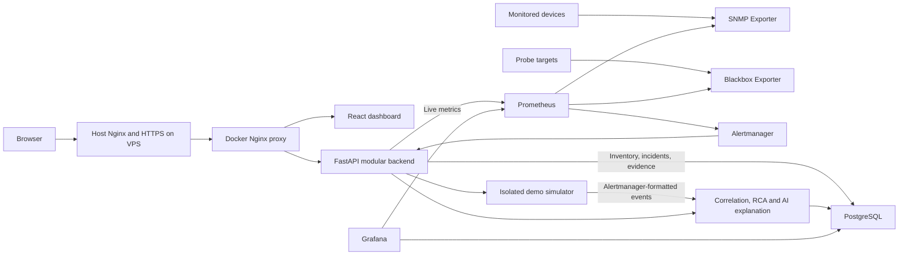

# NEXUS AI

Self-hosted network monitoring, incident correlation, and evidence-based diagnosis. The dashboard covers device inventory, network health, anomalies, ranked root causes, an AI explanation assistant, and a simulated incident workflow.

## Self-hosted quickstart

Install Docker Engine or Docker Desktop with Compose v2. From the repository root, copy `.env.example` to `.env` and replace the sample PostgreSQL and Grafana credentials. Use `Copy-Item .env.example .env` on PowerShell or `cp .env.example .env` on Linux.

```sh
docker compose up -d
docker compose ps
curl --fail http://127.0.0.1:8080/api/v1/simulator/scenarios
```

Open [the NEXUS AI dashboard](http://127.0.0.1:8080/). The backend applies Alembic migrations at startup. After changing code, rebuild with `docker compose up -d --build`. If you use `-f deployment/docker-compose.yml` directly, pass `--env-file .env` from the repository root.

| Service | Local address |
|---|---|
| Dashboard and API proxy | http://127.0.0.1:8080 |
| FastAPI docs | http://127.0.0.1:8000/docs |
| Prometheus | http://127.0.0.1:9090 |
| Alertmanager | http://127.0.0.1:9093 |
| Grafana | http://127.0.0.1:3000 |

Keep the root `.env` out of Git. PostgreSQL uses a private Docker network. `docker compose down` preserves data volumes.

## VPS deployment with Nginx and HTTPS

1. Point a public DNS record such as `nexus.example.com` at your VPS. Allow inbound TCP 80 and 443. Install Docker and the Compose v2 plugin, then copy the project to the host.
2. Create the root `.env` using the quickstart. Set `WEB_BIND_ADDRESS=127.0.0.1`, `WEB_PORT=8080`, `DEMO_READ_ONLY_MODE=true`, and `LLM_PROVIDER=mock` for a public demo. Run `docker compose up -d --build` and check the local URL.
3. Install host Nginx and Certbot with its Nginx plugin using the [Certbot instructions for your OS](https://certbot.eff.org/instructions). On Debian or Ubuntu with the distribution packages, use `sudo apt install nginx certbot python3-certbot-nginx`. Add the configuration below to `/etc/nginx/conf.d/nexus-ai.conf` and replace the example domain.

```nginx
server {
    listen 80;
    server_name nexus.example.com;

    location / {
        proxy_pass http://127.0.0.1:8080;
        proxy_set_header Host $host;
        proxy_set_header X-Real-IP $remote_addr;
        proxy_set_header X-Forwarded-For $proxy_add_x_forwarded_for;
        proxy_set_header X-Forwarded-Proto $scheme;
        proxy_read_timeout 120s;
    }
}
```

4. Enable HTTPS and verify renewal and the dashboard.

```sh
sudo nginx -t
sudo systemctl reload nginx
sudo certbot --nginx --redirect -d nexus.example.com
sudo certbot renew --dry-run
curl --fail https://nexus.example.com/api/v1/simulator/scenarios
```

Public demo mode blocks inventory writes and external Alertmanager submissions through the web proxy. The internal Alertmanager receiver and simulator remain available. Use a dedicated demo deployment because the dashboard exposes shared incident data and visitors can trigger, recover, or reset shared demo scenarios. Keep FastAPI, Grafana, Prometheus, and the Docker proxy bound to loopback. Use a private deployment for real network data and credentials.

## Architecture



## 5-minute live demo

1. Open **Demo Simulator** and click **Seed topology**. Visit **Device Inventory** to see `HCM-HQ-Lab`, its five devices, and the directed dependency links. Triggering a scenario also seeds the topology if needed.
2. Click **Simulate WAN Cascade Outage**. The dashboard opens the generated incident. Check the timeline for the WAN interface alert appearing 10 seconds ahead of downstream probe failures. Expand the RCA evidence for **ISP-WAN-Gateway**, then review the pre-generated assistant explanation and read-only checklist.
3. Return to **Demo Simulator** and run **Simulate VPN Tunnel Down** or **Simulate Traffic Anomaly Spike**. In **Anomaly Detection**, review packet loss for the VPN and the Z-Score and Isolation Forest results for the router's Gi0/1 traffic spike.
4. Click **Recover All**. Open the incident again to see its resolved alerts and recovery audit entry. Recovery checks use labeled synthetic telemetry, while live recovery checks query Prometheus.
5. Click **Reset Demo Data** to clear simulator-created incidents, alerts, anomaly results, and their associated RCA and assistant records. The topology and live records remain available.

| Simulator endpoint | Purpose |
|---|---|
| `GET /api/v1/simulator/scenarios` | List scenarios and their active incident IDs |
| `POST /api/v1/simulator/seed-topology` | Seed or return the lab topology |
| `POST /api/v1/simulator/trigger/{scenario}` | Run `wan_outage`, `vpn_tunnel_down`, or `bandwidth_spike` |
| `POST /api/v1/simulator/recover/{scenario}` | Resolve and verify an active simulation |
| `POST /api/v1/simulator/reset` | Clear demo records while preserving topology |

## Monitoring operations

Edit the file-discovery inventory under `monitoring/prometheus/targets/` to register lab SNMP and blackbox targets. Use read-only SNMP credentials and restrict access to the exporter. The included mock router has a Docker-only SNMP endpoint. Check scrape health in Prometheus and the provisioned network dashboard in Grafana.

See [architecture](docs/architecture.md), [deployment](docs/deployment.md), [operations](docs/operations.md), and [security](docs/security.md) for additional notes.
